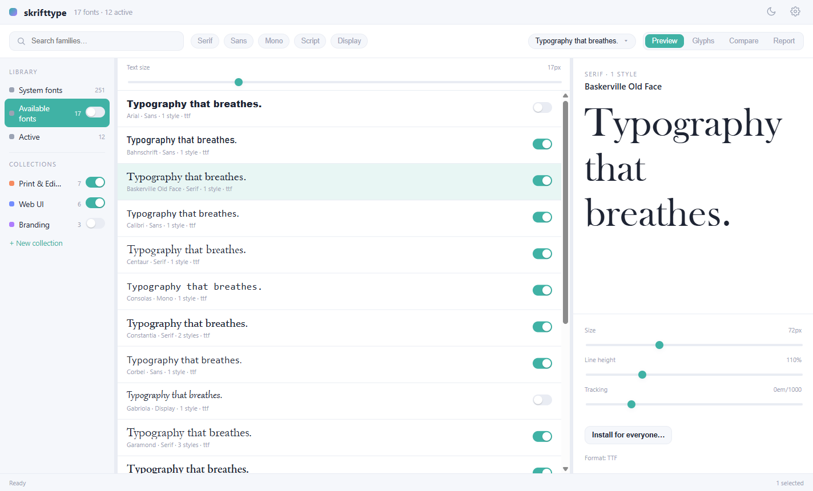
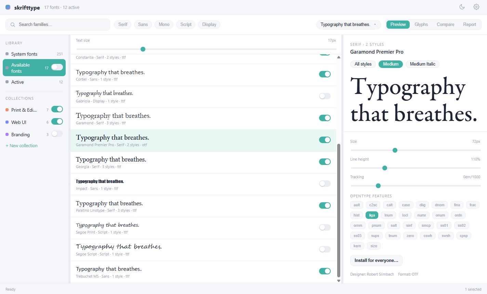
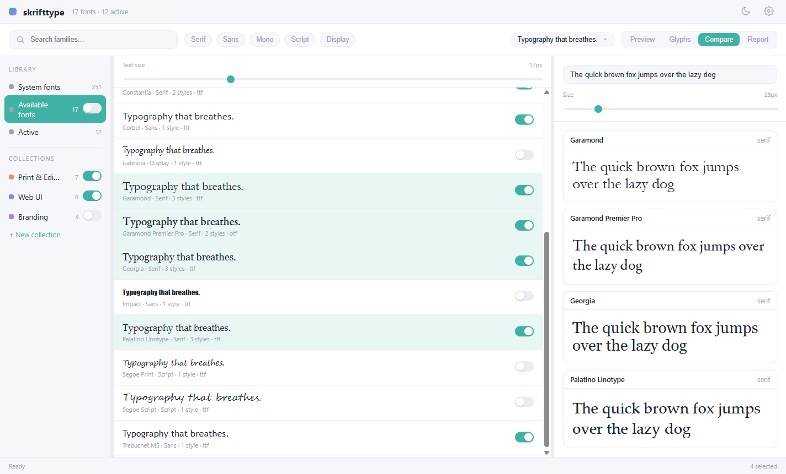
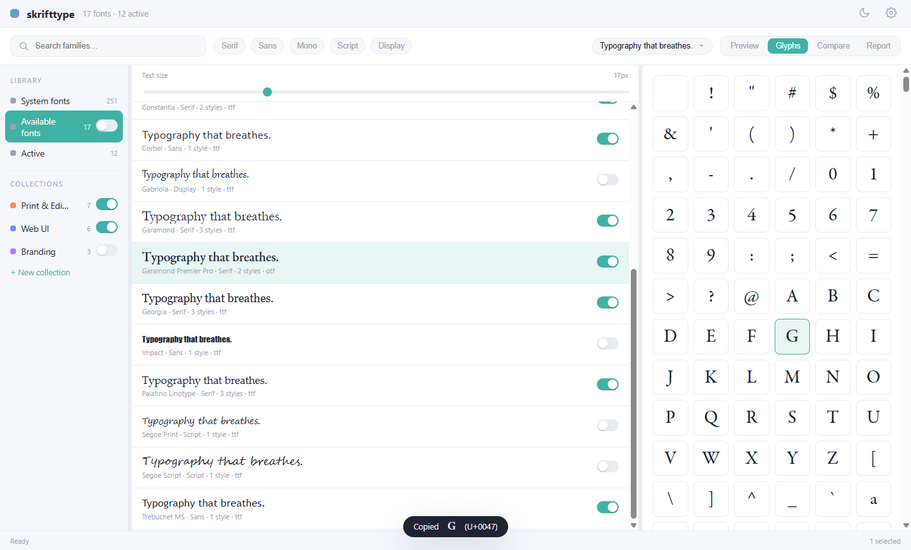
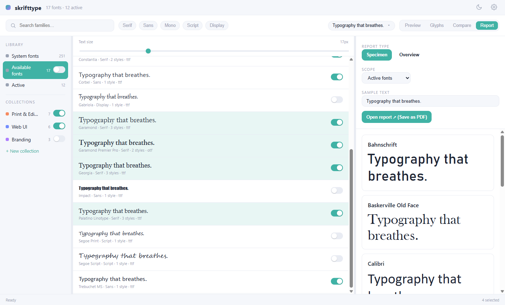
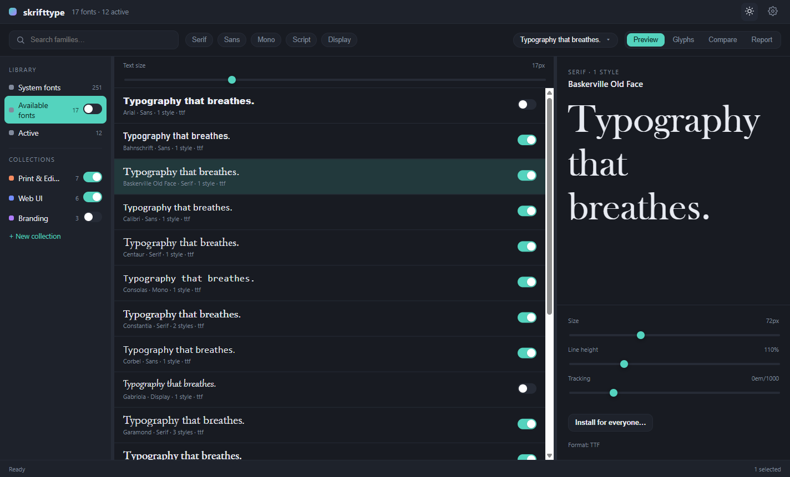

# Skrifttype

**A local-first font library that activates fonts on demand.**

Skrifttype (from the Scandinavian word for *typeface*) is a desktop font
manager for Windows. Point it at the folders where your fonts already live and
it builds a searchable, classified catalogue — without copying, moving, or
installing anything. When you need a font, **activate it on demand** so every
running application can see it; deactivate it when you're done. No more
cluttering the system font list with hundreds of faces you use twice a year.

Everything stays on your machine: a single SQLite catalogue, your fonts left
exactly where they are, and no account, cloud, or telemetry.



**Website:** <https://skrifttype.anovelproject.com/>

> **Status:** active development, pre-1.0. The app works end to end on
> Windows: folders are catalogued and watched, the library, previews,
> comparison, glyph map, reports and collections run on real data, and fonts
> activate on demand (and system-wide via an elevated helper). Expect rough
> edges.

---

## Why?

Designers and developers accumulate hundreds or thousands of font files across
client folders, downloads, and asset libraries. Installing them all bloats the
system, slows down apps, and turns every font picker into a scroll of doom.
Skrifttype keeps your fonts where they already are and only makes a font
*visible to the system* when you ask — so your installed-fonts list stays lean
and your creative apps stay fast.

It's **local-first by design**: no account, no sync server, no telemetry. Your
font files are never moved or modified, and the catalogue is a single SQLite
database you can delete at any time.

## Features

- 📁 **Watched folders** — point Skrifttype at the directories where your fonts
  already live (recursively, optionally) and it catalogues them in place. Files
  are never copied or moved. Folders are **watched live**: fonts you add,
  rename or delete show up within a couple of seconds. Installed system fonts
  have their own read-only *System fonts* scope.
- 🔎 **OpenType metadata parsing** — typographic family and style, weight,
  width, italic, variable-font flag, GSUB/GPOS feature tags and `cmap`
  coverage are read straight from each font's tables (pure-Go `sfnt` parser
  plus raw table readers; TTF and OTF).
- 🏷️ **Automatic classification** — serif / sans / mono / script / display
  from `post`, `OS/2` family class and PANOSE, with family-name hints as a
  last resort.
- ⚡ **On-demand activation** *(Windows)* — make a font available to every
  running application via GDI (`AddFontResourceExW` + one `WM_FONTCHANGE`
  broadcast per action) without installing it. Apps such as Photoshop, Word,
  and Affinity pick it up without a restart; deactivating drops it again.
  Active fonts are unloaded when Skrifttype quits and restored when it starts.
- 🗂️ **Collections** — group fonts (drag rows, or a multi-selection, onto a
  collection, or create one around your selection), give each a colour, and
  switch the whole set on or off together. Collections can be renamed and
  recoloured at any time. Activation is source-tracked: a font stays loaded
  while anything still needs it.
- 🔛 **Bulk activation** — one switch on *Available fonts* activates or
  deactivates everything in your watched folders, with a confirmation and live
  progress.
- 👁️ **Previews** — fonts render from their own files (even when not
  installed). Pick a phrase from the toolbar to set every font row in its own
  face, and pick any style of a family. The preview has size, line-height and
  tracking controls plus live OpenType feature toggles (ligatures, small caps,
  figures, stylistic sets and more). Variable fonts are flagged.
- ⚖️ **Comparison** — Ctrl/Shift-click two to four fonts and see them side by
  side with shared text and size.
- 🔣 **Glyph map** — every character in the font in a grid; click one to copy
  it, with a confirmation showing the character and its Unicode code point.
- 🖨️ **Reports** — printable specimen and overview reports for active fonts, a
  collection, the library or system fonts, openable as a PDF.
- 🌗 **Light and dark themes**, a resizable sidebar with font counts, and a
  short first-run walkthrough you can replay from Settings.
- 🔐 **Install for everyone** *(Windows)* — copy a font into `%WINDIR%\Fonts`
  for all users via a small elevated helper (`font-helper.exe`, one UAC prompt
  per action); Skrifttype itself never runs elevated, and it only offers to
  uninstall fonts it installed.
- 🧩 **Font collections and web fonts** — TTC/OTC collections and
  WOFF/WOFF2 files are catalogued, browsable and previewable. Web fonts cannot
  be activated on Windows, so they are shown as such. A **Convert...** action
  (only ever on request) writes plain TTF/OTF copies, or splits a collection
  into one file per face, into a conversion folder you set in Settings or pick
  when converting; the original is never touched or overwritten.
- 💾 **Local-first storage** — one SQLite catalogue under
  `%LOCALAPPDATA%\skrifttype\`; no cloud, no account, no telemetry.
- 🪟 **Window state** — size and position are remembered between sessions.

## Screenshots

| Preview | Compare |
|---|---|
|  |  |
| **Glyph map** | **Reports** |
|  |  |



## Platform support

Skrifttype is **Windows-first**. On-demand activation is implemented with the
Win32 GDI font API and only works on Windows. The codebase compiles and runs on
macOS and Linux (the activation layer falls back to a no-op stub), which keeps
development and CI cross-platform, but the core feature is Windows-only for now.

### Requirements

- **Windows**: 10 or later. The installer puts Skrifttype in
  `C:\Program Files\Skrifttype` and downloads the WebView2 Runtime if it's
  missing. The installer is **unsigned**, so SmartScreen shows a *"Windows
  protected your PC"* warning on first run — click *More info* → *Run anyway*.
  (Code-signing certificates are prohibitively expensive for an unfunded OSS
  project.)
- **macOS / Linux**: builds run, but font activation is a no-op stub.

## Install

Pre-built installers are published on the
[Releases page](https://github.com/amnuts/skrifttype/releases) when a version is
tagged. Until the first release lands, build from source (see below).

| Platform | File |
|---|---|
| Windows (x64) | `skrifttype-<version>-windows-amd64-installer.exe` |
| Windows (ARM64) | `skrifttype-<version>-windows-arm64-installer.exe` |
| macOS (universal) | `skrifttype-<version>-macos-universal.zip` |
| Linux (AppImage) | `skrifttype-<version>-linux-amd64.AppImage` |
| Linux (Debian/Ubuntu) | `skrifttype-<version>-linux-amd64.deb` |
| Linux (RHEL/Fedora) | `skrifttype-<version>-linux-amd64.rpm` |

### Expect security warnings

The releases are not code-signed (no certificate), so your OS will warn you
the first time. The builds are made by the public
[release workflow](.github/workflows/release.yml) from the tagged source.

- **Windows SmartScreen**: *"Windows protected your PC"*. Click *More info*,
  then *Run anyway*.
- **Windows UAC**: "Install for everyone" asks for administrator rights and
  shows the publisher as *Unknown*. That is expected; the prompt is for
  `font-helper.exe`, installed alongside the app.
- **Browsers and antivirus**: an unsigned installer may be flagged as
  uncommon. If you'd rather not trust a binary, build from source (below).
- **macOS**: Gatekeeper blocks the app at first launch. Right-click it, choose
  *Open*, then confirm.

## Development

Skrifttype builds with Wake, Wails' experimental YAML build system (see
`wails.yaml`). Prerequisites: Go 1.26+, Node 22+, the Wails v3.1 CLI, and
[NSIS](https://nsis.sourceforge.io/) (`makensis`) if you want to build the
Windows installer.

### Windows (PowerShell)

```powershell
go install github.com/wailsapp/wails/v3/cmd/wails3@v3.1.0

# Wake is opt-in; set this in every terminal that runs wails3
$env:WAILS_EXP_USE_WAKE = '1'

# Run in dev mode (hot reload for Go + frontend)
wails3 dev

# Build skrifttype.exe and font-helper.exe into bin/
wails3 build

# Package the NSIS installers (amd64 + arm64) into bin/windows-<arch>/
wails3 build windows

# Run Go tests
go test ./...

# Regenerate frontend TypeScript bindings after changing Go service signatures
wails3 generate bindings -clean=true -ts -i
```

### macOS / Linux

```bash
go install github.com/wailsapp/wails/v3/cmd/wails3@v3.1.0
export WAILS_EXP_USE_WAKE=1

wails3 dev                # dev mode
wails3 build              # build for the current OS
wails3 build macos        # .app (universal); or: wails3 build linux
                          # for AppImage + deb + rpm
go test ./...
```

Linux also needs `libgtk-4-dev` and `libwebkitgtk-6.0-dev` (GTK 4, the Wails 3.1 default; Ubuntu 24.04 or later).

Two environment variables help when developing or debugging the packaged app:

- `SKRIFTTYPE_DATA_DIR` — use a throwaway profile (catalogue, window state,
  log and WebView2 data) instead of `%LOCALAPPDATA%\skrifttype`.
- `SKRIFTTYPE_WEBVIEW_DEBUG_PORT` — expose the Chrome DevTools protocol on that
  localhost port, so you can inspect or script the running UI.

Logs are written to `skrifttype.log` in the data directory (a GUI build has no
console).

> On Windows, Skrifttype builds with `CGO_ENABLED=0` — the SQLite driver is the
> pure-Go `modernc.org/sqlite`, and the WebView2 runtime needs no C compiler, so
> no toolchain setup is required. macOS and Linux link against the system
> WebKit, which Wails compiles via CGO.

## Architecture

- **Backend**: Go + [Wails v3](https://v3.wails.io/), SQLite via the
  pure-Go `modernc.org/sqlite` driver (no CGO for the database).
- **Frontend**: [Lit](https://lit.dev/) web components + TypeScript, bundled
  with Vite, styled with Puppertino CSS.
- **Font engine**: OpenType parsing via `golang.org/x/image/font/sfnt`;
  activation via the Win32 GDI font API.

## Project layout

- `main.go`, `windowstate.go` — Wails entry point, service wiring, persisted
  window geometry and development switches.
- `internal/api/` — the Wails services the frontend calls (library,
  activation, collections, settings, system install), the family catalogue,
  and the `/fontfile/<id>` handler that serves font files to previews.
- `internal/activation/` — the activation orchestrator: records intent in the
  store, reconciles it with what GDI has loaded, broadcasts once per action.
- `internal/library/` — directory scanner, OpenType parser and classifier,
  system-font sync, and the live folder watcher.
- `internal/store/` — SQLite persistence and schema migrations.
- `internal/winfont/` — Win32 GDI font activation, system-font enumeration and
  the UAC launcher for the helper (with non-Windows stubs).
- `cmd/font-helper/` — the elevated system-install helper
  (`requireAdministrator`), shipped next to `skrifttype.exe`.
- `pkg/helperproto/` — the JSON wire protocol between the app and the helper.
- `frontend/` — Lit application (`src/`) and generated Wails bindings
  (`bindings/`).
- `build/` — per-OS packaging assets (NSIS, manifests, plists) and icons; the build itself is `wails.yaml`.

## Author

Skrifttype is built by [Andrew Collington](https://github.com/amnuts). Bug
reports and feature requests are welcome on the
[issue tracker](https://github.com/amnuts/skrifttype/issues).

## License

[MIT](LICENSE), copyright (c) Andrew Collington. See
<http://acollington.mit-license.org/>.
